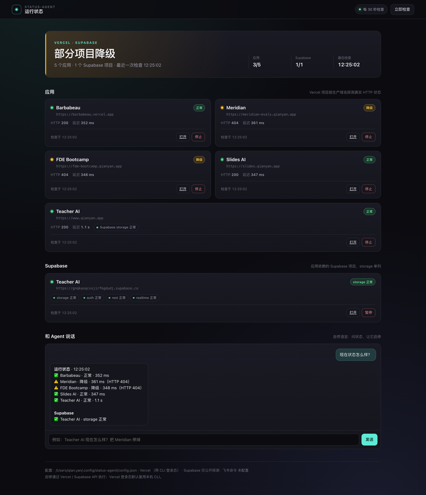

# status-agent

A small, self-contained **ops agent** for **your Vercel projects** and the **Supabase services they
depend on**. It watches them, answers questions in natural language, runs start/stop for you, and
pushes an alert when something changes.

It is deliberately a separate project: no slides, no static-site build, no dependency on any other repo.

The agent design (role, perception, tools, loop, memory, safety) is in [docs/AGENT.md](docs/AGENT.md).



## What it shows

- **Applications** — every Vercel project's production URL, probed from the server, so you get the real
  HTTP status code and latency (a 404 such as `DEPLOYMENT_NOT_FOUND` shows up as 降级, not as "up").
- **Supabase** — for each app, the Supabase project it talks to, with `storage`, `auth`, `rest` and
  `realtime` health. `storage` has its own status badge because that is usually the piece that breaks.
- **Alerts** — status changes are pushed to the Feishu chat once (down, degraded, recovered).
- **Controls** — stop/start a Vercel project (pause/unpause) and pause/restore a Supabase project.

Project discovery uses the local Vercel CLI, so you do not have to paste a token. Supabase project refs
are read from each app's own JS bundle; you can also pin them in the config.

## Requirements

- Node.js >= 22 (no runtime dependencies)
- A logged-in Vercel CLI (`npm i -g vercel && vercel login`) for discovery and pause/unpause
- Optional: a Supabase personal access token for authoritative per-service health
- Optional: `lark-cli` logged in as your bot, for the Feishu command channel

## Quick start

```bash
cp config.example.json ~/.config/status-agent/config.json
$EDITOR ~/.config/status-agent/config.json      # apps, tokens, Feishu chat
node agent.mjs --check                          # validate the config
node agent.mjs                                  # dashboard on http://127.0.0.1:8787/
```

`node agent.mjs --once` prints one status snapshot to the terminal.

## Configuration

`~/.config/status-agent/config.json` (override with `--config <path>` or `STATUS_AGENT_CONFIG`):

```json
{
  "intervalMs": 30000,
  "vercel": { "scope": "my-team", "teamId": "team_xxx", "cliPath": "vercel" },
  "supabase": { "token": "" },
  "feishu": {
    "larkCli": "lark-cli",
    "chatId": "oc_xxx",
    "ownerOpenId": "ou_xxx"
  },
  "apps": [
    {
      "id": "teacher-ai",
      "name": "Teacher AI",
      "url": "https://www.example.com",
      "vercelProjectId": "prj_xxx",
      "supabaseRef": "abcdefghijklmnopqrst"
    }
  ]
}
```

- `apps` may be empty — projects are discovered from `vercel project ls --json` every 5 minutes.
- `vercel.token` is optional. Without it the agent reuses the token the Vercel CLI already stores
  (`~/Library/Application Support/com.vercel.cli/auth.json` on macOS, the XDG path on Linux).
- `supabase.token` is a personal access token (`sbp_...`). Without it the agent still probes
  `storage/v1/status`, `auth/v1/health`, `rest/v1/` and `realtime/v1/` publicly.
- `feishu.chatId` / `feishu.ownerOpenId` enable the chat channel; only that person, in that chat, can
  use it.

## The agent

Chat with it in the dashboard or in Feishu. With an LLM configured it understands natural language and
picks tools itself; without one it falls back to the built-in commands, so it never goes silent.

```json
"llm": { "baseUrl": "https://api.deepseek.com/v1", "apiKey": "sk-...", "model": "deepseek-chat" }
```

Any OpenAI-compatible chat-completions endpoint works. The model only chooses tools — every number in
the answer comes from a probe, never from the model.

## Feishu commands

| Command | Effect |
| --- | --- |
| `状态` | full snapshot (apps + Supabase) |
| `应用` | list what can be controlled |
| `停 <名字>` | pause the app's Vercel project / the Supabase project |
| `启 <名字>` | unpause / restore |
| `帮助` | command list |

Replies are sent as the bot in the configured chat. Alerts are pushed to the same chat.

## Run it forever (macOS)

```bash
./install-macos.sh
```

Copies the agent to `~/.local/share/status-agent`, writes
`~/Library/LaunchAgents/com.lambeta.status-agent.plist`, and starts it. Logs go to
`~/Library/Logs/status-agent.log`. Remove it with `launchctl bootout gui/$(id -u) ~/Library/LaunchAgents/com.lambeta.status-agent.plist`.

## How it works

- `lib/agent.mjs` — the LLM tool loop (`get_status`, `refresh_status`, `control_app`, `control_supabase`)
- `agent.mjs` — CLI, HTTP server, monitor loop, Feishu consumer
- `lib/services.mjs` — probes and API calls (Vercel, Supabase, project discovery)
- `lib/monitor.mjs` — merges discovered apps with the config, tracks transitions, persists last states
- `lib/commands.mjs` — command parsing and replies
- `lib/http.mjs`/`lib/server.mjs` — dashboard API and static files
- `lib/feishu.mjs` — `lark-cli event consume` wrapper and message sending
- `public/` — the dashboard (no framework, no build step)

## Limitations

- The dashboard binds to `127.0.0.1` by default; it is a local tool, not a hosted service.
- The Feishu channel needs `lark-cli` on the PATH and a bot that is a member of the chat.
- Supabase pause/restore requires the personal access token; without it the project is read-only.
